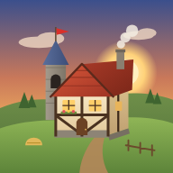
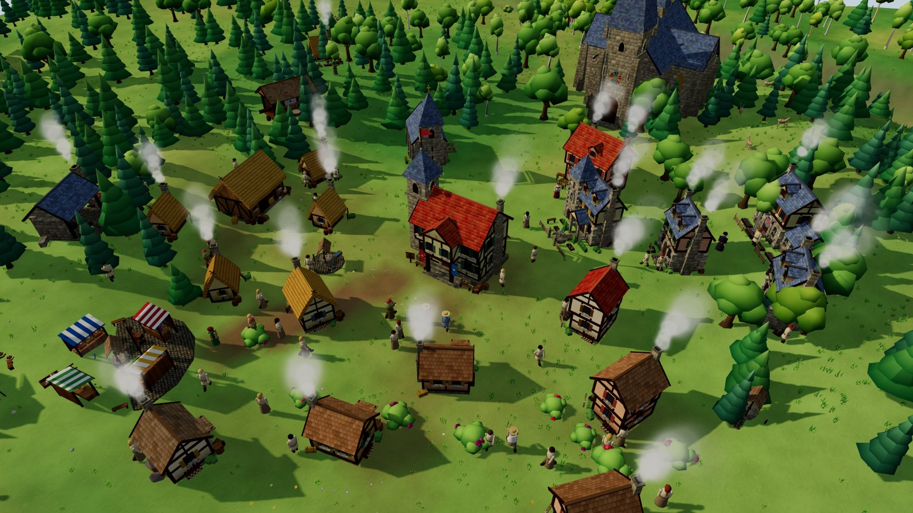
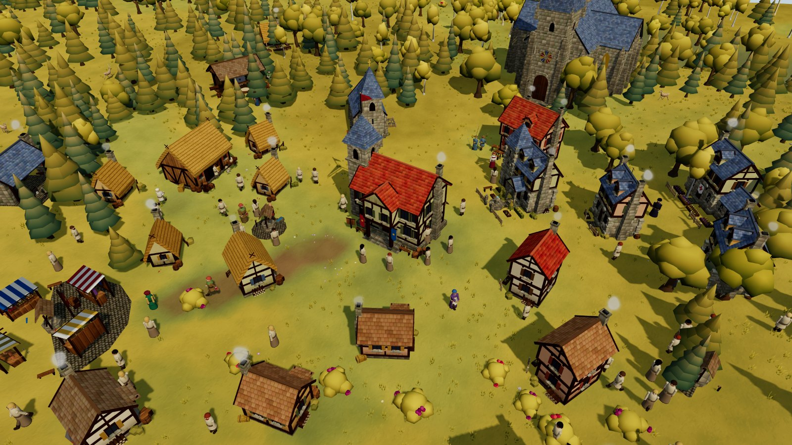
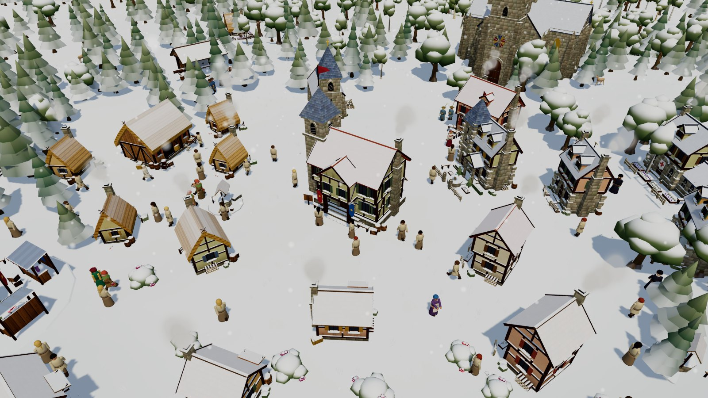
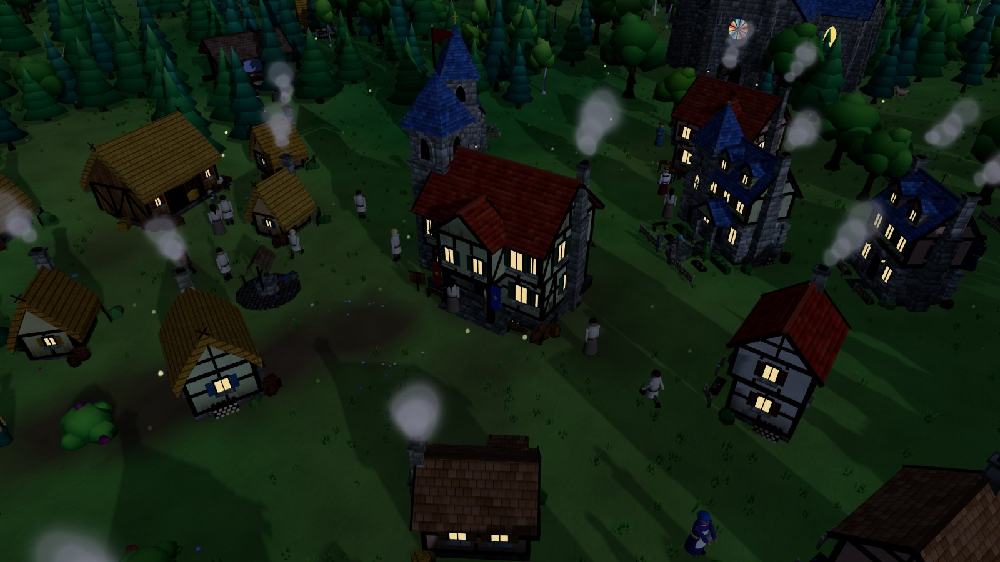
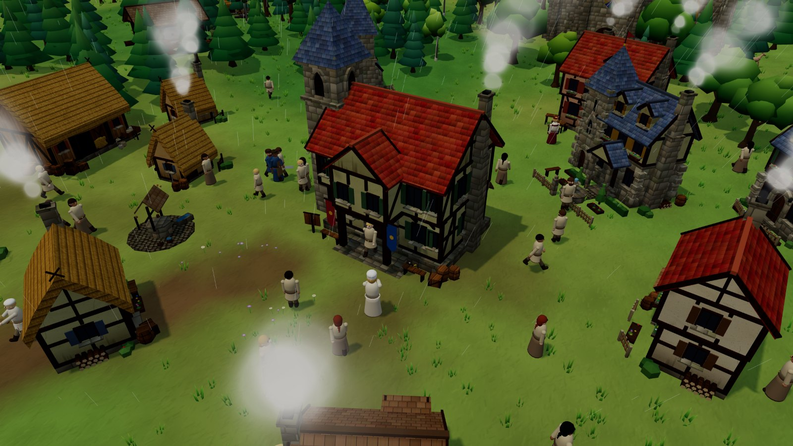
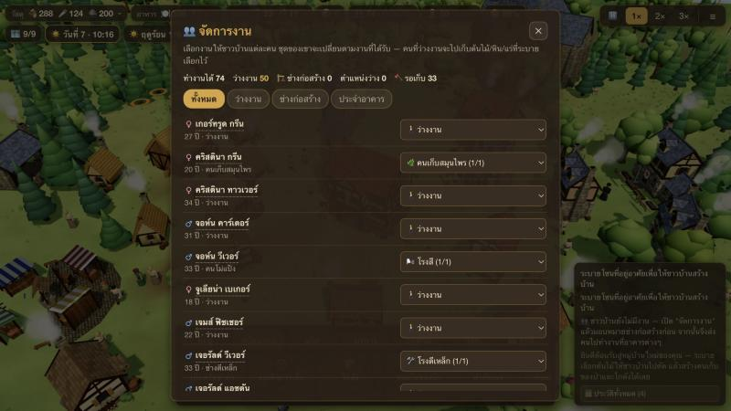
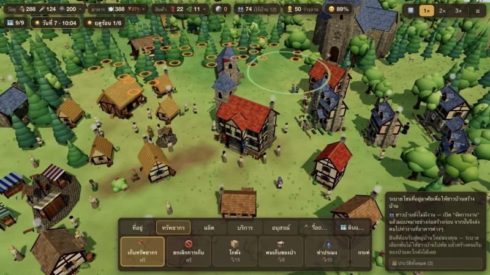
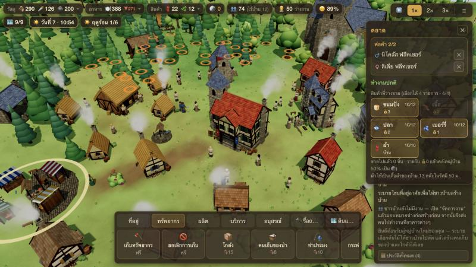
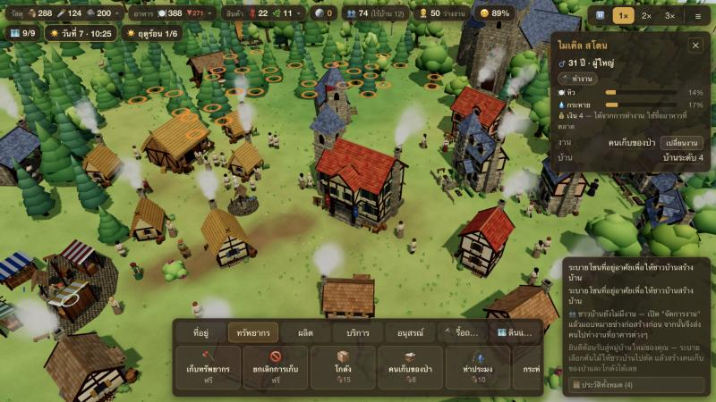

<div align="center">



# Hamlet — หมู่บ้านยุคกลาง

**สร้างหมู่บ้านเล็กๆ ให้เติบโตเป็นเมืองยุคกลาง ดูแลชาวบ้านทุกคนที่มีชื่อ มีครอบครัว และมีชีวิตของตัวเอง**<br>
เกม 3D แนว city-builder เล่นบนเบราว์เซอร์ได้ทันที — ไม่ต้องติดตั้ง เล่นบน iPad ได้ เล่นออฟไลน์ได้

*A cozy medieval village builder in your browser — every villager has a name, a family and a job you choose.*

### [▶ เล่นเลยที่ hamlet.codex074.com](https://hamlet.codex074.com)




</div>

---

## 🌸 สี่ฤดูที่เปลี่ยนทั้งหมู่บ้าน

ปีหนึ่งมี 4 ฤดู อากาศเปลี่ยนทุกครึ่งวัน — ฝนโปรยในฤดูใบไม้ผลิ ใบไม้เปลี่ยนเป็นสีทองในฤดูใบไม้ร่วง และหิมะค่อยๆ ปกคลุมหลังคากับยอดไม้ในฤดูหนาว
ฤดูกาลไม่ได้มีไว้สวยอย่างเดียว: ไร่นาให้ผลน้อยลงในหน้าหนาว เบอร์รี่แทบไม่งอก และชาวบ้านหิวเร็วขึ้น — **เตรียมเสบียงให้พอก่อนหิมะแรกจะตก**

<table>
  <tr>
    <td width="50%"><br><sub>🍂 <b>ใบไม้ร่วง</b> — ฤดูเก็บเกี่ยว ไร่นาให้ผลดี</sub></td>
    <td width="50%"><br><sub>❄️ <b>ฤดูหนาว</b> — หิมะสะสมบนพื้นและหลังคา เดินช้าลง</sub></td>
  </tr>
  <tr>
    <td width="50%"><br><sub>🌙 <b>ยามค่ำคืน</b> — ไฟในหน้าต่าง หิ่งห้อย และกระจกสีของมหาวิหาร</sub></td>
    <td width="50%"><br><sub>🌧️ <b>วันฝนตก</b> — ฟ้าครึ้ม พื้นเปียก ชาวบ้านกระหายน้ำช้าลง</sub></td>
  </tr>
</table>

---

## 👥 ชาวบ้านทุกคนเป็นคนจริงๆ



ชาวบ้านทุกคนมี **ชื่อ-นามสกุล อายุ และครอบครัว** — พวกเขาแต่งงาน มีลูก ลูกเติบโตเป็นผู้ใหญ่ และจากไปเมื่อถึงวัย

**คุณเป็นคนเลือกเองว่าใครทำอะไร** ระบบไม่ส่งใครไปทำงานให้ — กด <kbd>J</kbd> เปิดแผงจัดการงาน แล้วเลือกได้ว่าจะให้ใครเป็นช่างก่อสร้าง ชาวนา นักบวช หมอ หรือพ่อค้า
พอได้งาน ชาวบ้านจะ **เปลี่ยนชุดตามหน้าที่** ทันที: หมวกฟางของชาวนา ชุดขาวของคนทำขนมปัง ชุดคลุมสีน้ำตาลของนักบวช…

ชาวบ้านมีทั้ง **ความหิว ความกระหาย** และเงินค่าจ้างของตัวเอง ยิ่งเดินไกลยิ่งเหนื่อย — วางโกดัง บ่อน้ำ และตลาดให้ใกล้บ้านกับที่ทำงาน

<br clear="right">

---

## 🪓 ระบายเลือก แล้วชาวบ้านจะไปเก็บให้



ไม่ต้องสร้างโรงตัดไม้ — เลือก **🪓 เก็บทรัพยากร** แล้ว **ระบายคลุมต้นไม้ ก้อนหิน หรือสายแร่** ที่ต้องการ
ทุกจุดที่เลือกจะมีวงสีกะพริบ แล้วชาวบ้านที่ว่างงานจะเดินไปตัด ขุด และแบกเข้าโกดังที่ใกล้ที่สุดเอง ต้นไม้และหินจะเล็กลงทุกครั้งที่ถูกตัด/ขุดจนหายไป

ก้อนหินบนพื้นมีจำกัด — เมื่อหมดต้องพึ่ง **⛏️ เหมืองหิน** ที่ขุดได้ไม่จำกัด (คนงานสูงสุด 10 คน) แต่เป็นงาน **เสี่ยงอุบัติเหตุ** ถึงขั้นบาดเจ็บหรือเสียชีวิต — เครื่องมือจากโรงตีเหล็กช่วยลดความเสี่ยงและขุดเร็วขึ้น

---

## 🏪 ตลาด เงิน และเศรษฐกิจของหมู่บ้าน

<table>
  <tr>
    <td width="50%"></td>
    <td width="50%"></td>
  </tr>
  <tr>
    <td><sub><b>ตลาด</b> — เลือกสินค้าที่จะวางขายได้ 4 อย่าง พ่อค้าขนของจากโกดังมาเติม ชาวบ้านใช้ค่าจ้างซื้ออาหารกินใกล้บ้าน รายได้ครึ่งหนึ่งเข้าคลังหมู่บ้าน</sub></td>
    <td><sub><b>ชาวบ้านทุกคน</b> — ดูความหิว ความกระหาย เงิน งาน บ้าน และครอบครัวได้ แล้วเปลี่ยนงานได้ทันที</sub></td>
  </tr>
</table>

---

## ✨ มีอะไรให้ทำบ้าง

| | |
|---|---|
| 🏘️ **บ้านโตตามความเป็นอยู่** | ระบายโซนที่อยู่ ชาวบ้านสร้างบ้านเอง บ้านอัปเกรดได้ 5 ระดับเมื่อได้รับอาหาร น้ำ ศาสนา ความบันเทิง สุขภาพ และเสื้อผ้าครบ |
| 🍞 **ห่วงโซ่การผลิต** | ข้าวสาลี → แป้ง → ขนมปัง · ขนแกะ → ผ้า → เสื้อผ้า · แร่เหล็ก → เครื่องมือ → ทำงานเร็วขึ้น |
| 💧 **น้ำและการเดิน** | ชาวบ้านดื่มน้ำที่บ่อน้ำหรือริมแม่น้ำที่ใกล้ที่สุด ทางที่เดินบ่อยจะกลายเป็นทางดินและเดินเร็วขึ้นเอง |
| 👪 **ครอบครัวหลายรุ่น** | แต่งงาน ตั้งครรภ์ เด็กโตเป็นผู้ใหญ่ ผู้สูงอายุทำได้เฉพาะงานเบา ดูสมาชิกครอบครัวของแต่ละบ้านได้ |
| 🤒 **ความเจ็บป่วย** | คนอดอยาก ขาดน้ำ หรือในฤดูหนาวป่วยง่ายขึ้น หมอที่สถานพยาบาลใช้สมุนไพรรักษา |
| 🗺️ **ขยายดินแดน** | ซื้อแปลงที่ดินใหม่ด้วยทอง เพื่อเข้าถึงป่า แม่น้ำ และสายแร่ |
| 🏰 **มหาวิหาร** | เป้าหมายใหญ่ของหมู่บ้าน สร้างทีละ 4 ขั้น ต้องใช้วัสดุจำนวนมากและทอง |
| ⚙️ **ตั้งค่าโลกได้** | ขนาดแผนที่ จำนวนแม่น้ำ ภูมิประเทศ ป่าฟื้นตัว ทรัพยากรเริ่มต้น และความยาก 3 ระดับ |
| 📱 **เล่นได้ทุกที่** | เมาส์และคีย์บอร์ด หรือทัชบน iPad (บีบซูม หมุนสองนิ้ว) ติดตั้งเป็นแอป (PWA) และเล่นออฟไลน์ได้ |
| ☁️ **เซฟบนคลาวด์** | สมัครด้วยอีเมลหรือ Google มีหมู่บ้านได้ 3 แห่งต่อบัญชี เล่นต่อจากเครื่องไหนก็ได้ |

---

## 🚀 10 นาทีแรก

> เกมใหม่จะมี **🎯 คำแนะนำเริ่มต้น** มุมซ้ายบนพาทำทีละขั้น — กด 👀 **แสดงให้ดู** แล้วเกมจะเปิดเมนูที่ถูกต้องและพากล้องไปยังจุดที่ควรวางให้เอง เคยเล่นแล้วกด ✕ ข้ามได้เลย

1. กด **👷** บนแถบด้านบน (หรือ <kbd>J</kbd>) แล้วตั้ง **ช่างก่อสร้าง** 2–3 คน — ไม่มีช่าง = ไม่มีใครสร้าง
2. **ระบายโซนที่อยู่อาศัย** ใกล้ศาลากลาง ช่างจะสร้างบ้านให้เอง
3. วาง **คนเก็บของป่า** ใกล้พุ่มเบอร์รี่ แล้วเลือกคนงาน (สูงสุด 4 คน) — นี่คืออาหารชุดแรก
4. ใช้ **🪓 เก็บทรัพยากร** ระบายคลุมต้นไม้และก้อนหินใกล้ๆ ชาวบ้านที่ว่างจะไปเก็บมาให้
5. สร้าง **🪣 บ่อน้ำ** ใกล้บ้าน แล้วกด <kbd>3</kbd> เร่งเวลา — ถ้าชาวบ้านมีความสุขและอาหารพอ จะมีคนย้ายเข้ามาทุกเที่ยงคืน
6. ประชากร 6 → **โบสถ์** · 12 → **ฟาร์ม / โรงสี / ร้านขนมปัง / ตลาด** · 20 → **โรงเตี๊ยม** · 25 → **มหาวิหาร**

คู่มือฉบับเต็มอยู่ในเกม: ปุ่ม ☰ มุมขวาบน → 📖 วิธีเล่น

## 🎮 การควบคุม

| | เมาส์ / คีย์บอร์ด | ทัช (iPad) |
|---|---|---|
| เลื่อนกล้อง | <kbd>W</kbd><kbd>A</kbd><kbd>S</kbd><kbd>D</kbd> / ลูกศร / ลากเมาส์ซ้าย | ลากนิ้วเดียว |
| หมุน / ซูม | <kbd>Q</kbd> <kbd>E</kbd> / ลากเมาส์ขวา · ล้อเมาส์ | หมุนสองนิ้ว · บีบ/กาง |
| หมุนอาคารก่อนวาง | <kbd>R</kbd> หรือ <kbd>Shift</kbd> + ล้อเมาส์ | ปุ่ม ↻ |
| ขนาดแปรง | <kbd>[</kbd> <kbd>]</kbd> | ปุ่ม − + |
| จัดการงาน | <kbd>J</kbd> | ชิป 👷 |
| 📷 โหมดถ่ายภาพ (ซ่อนหน้าจอ) | <kbd>H</kbd> | — |
| หยุด / ความเร็ว | <kbd>Space</kbd> · <kbd>1</kbd> <kbd>2</kbd> <kbd>3</kbd> | ปุ่มมุมขวาบน |
| ยกเลิก | <kbd>Esc</kbd> / คลิกขวา | ปุ่ม ✕ |

---

## 🛠️ สำหรับนักพัฒนา

เขียนด้วย JavaScript ล้วน + [three.js](https://threejs.org) — **ไม่มีขั้นตอน build** โมเดล 3D และพื้นผิวทุกชิ้นสร้างด้วยโค้ด (procedural) ไม่มีไฟล์โมเดลหรือ texture
ระบบจำลองเป็นโค้ดบริสุทธิ์ (ไม่แตะ DOM) จึงทดสอบด้วย Node ได้ทั้งหมด

```bash
npm test          # เทสต์ระบบจำลอง (Node 24) — 250+ เทสต์
./serve.sh        # เล่นในเครื่องแบบออฟไลน์ → http://localhost:8080
```

| โฟลเดอร์ | |
|---|---|
| `src/` | ระบบจำลอง (`sim.js`, `villagers.js`, `seasons.js`, `market.js`, `harvest.js` …) |
| `src/render/` | ฉาก 3D, โมเดลอาคาร, ตัวละคร, ธรรมชาติ, สภาพอากาศ |
| `src/ui/` | HUD, เครื่องมือ, คู่มือ, หน้าจอเลือกหมู่บ้าน |
| `server/` | Node 24 ไม่มี dependency + SQLite (บัญชีผู้ใช้และเซฟบนคลาวด์) |
| `dev/` | หน้าทดสอบโมเดล 3D (`dev/render-demo.html`) |
| `docs/specs/` | สเปกการออกแบบแต่ละระบบ |

เกมบันทึกอัตโนมัติทุก 30 วินาที — แบบออฟไลน์เก็บในเบราว์เซอร์, แบบออนไลน์เก็บบนเซิร์ฟเวอร์

<details>
<summary><b>Deploy (Hostinger VPS)</b></summary>

```bash
./deploy.sh
```
รันเทสต์ → อัปโหลดไป `/srv/hamlet/app` → `docker compose up -d --build` → health check
- server: Node 24 ไม่มี dependency (`server/`), SQLite ที่ `/srv/hamlet/data` (สำรองรายวันใน `backups/` เก็บ 14 วัน)
- ตั้งค่า: `/srv/hamlet/hamlet.env` (`GOOGLE_CLIENT_ID=...`)
- nginx: `/etc/nginx/sites-available/hamlet.codex074.com` (ต้นฉบับใน `deploy/`, certbot เพิ่ม TLS ให้แล้ว ต่ออายุอัตโนมัติ)
- log: `ssh hostinger 'docker logs hamlet-server --tail 100'`

เล่นจาก Mac เครื่องอื่นผ่าน Tailscale: บน Mac mini รัน `BIND=100.64.194.122 ./serve.sh` แล้วเปิด http://100.64.194.122:8080

</details>

<div align="center">
<br>

### [🏰 เริ่มสร้างหมู่บ้านของคุณ →](https://hamlet.codex074.com)

</div>
